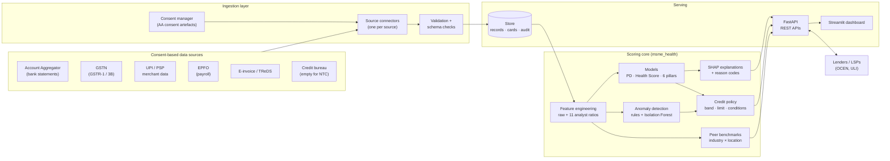
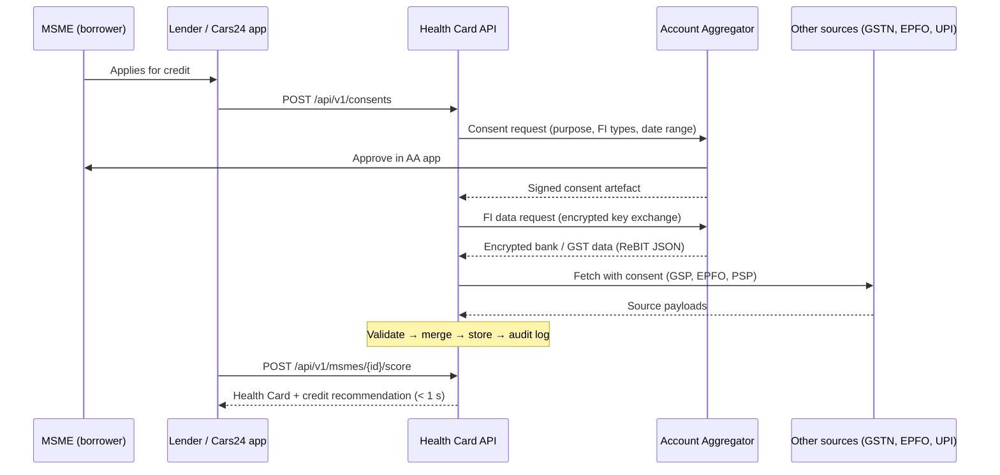
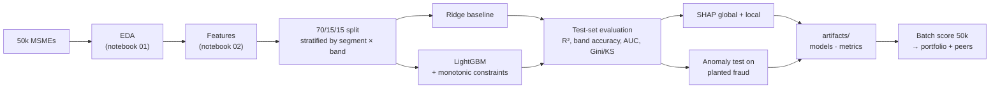

# Solution Architecture

## 1. End-to-end view

**Design principle:** one scoring core (`src/msme_health`) is shared by training, the API and the dashboard. The same `add_derived()` function computes features everywhere, so there is no training/serving skew.

## 2. Data ingestion pipeline

| Step | Demo implementation | Production implementation |
|---|---|---|
| Consent | `POST /consents` creates a mock artefact | AA consent manager, signed artefact, expiry + revocation handling |
| Fetch | `POST /msmes/{id}/fetch` calls one `MockConnector` per source | Real connectors behind the same `Connector` interface (`connectors.py`) |
| Partial push | `POST /msmes/{id}/sources/{source}` merges one source's fields | Webhooks / periodic AA fetch; Kafka topic per source |
| Validation | Pydantic schema with ranges (e.g. 0 ≤ % ≤ 100) | + cross-source reconciliation, deduplication, data-quality metrics |
| Storage | SQLite (records, cards, consents, audit) | Postgres + object storage (raw payloads, encrypted) + feature store |

## 3. AI/ML workflow

| Component | Choice | Why |
|---|---|---|
| PD target | log-odds of supplied PD | Skewed 0–1 value → smooth unbounded target |
| Main model | LightGBM regressor, monotonic constraints on 14 features | Handles blanks (no-loan EMI rate), interactions; constraints keep behaviour sensible |
| Baseline | Ridge on one-hot + scaled features | Scorecard-style; matches LightGBM on this data |
| Pillars | 6 small LightGBM models (500 trees) | Pillars are near-exact formulas; small models keep memory low |
| Explainability | TreeSHAP (LightGBM built-in `pred_contrib`, identical to the shap library): waterfall (points), pillar roll-up, reason codes | Additive, exact for trees; reason codes for adverse-action notices |
| Anomalies | 8 cross-source rules + Isolation Forest (2% alert rate) | Rules catch known fraud; IF catches unknown patterns |
| Decision | Policy layer: PD band → eligibility → min(policy limit, affordability limit) | Separates model from credit policy, as lenders do |

**Retraining in production:** monthly or on drift. Track PSI of inputs and scores, then compare challenger vs champion on new outcomes (real defaults at 90+ days past due). Promote via a model registry (MLflow) with sign-off from model-risk management.

## 4. Integration strategy

| Rail | What it is | How this solution plugs in |
|---|---|---|
| **Account Aggregator (AA)** | RBI-regulated consent layer for financial data (Sahamati network) | Lender registers as an **FIU**. The consent request covers DEPOSIT (bank statements) and GST FI types. Data arrives encrypted in the ReBIT schema and maps to our AA fields (credits, debits, balance, OD use, volatility, EMI debits). Periodic fetch under the same consent allows **ongoing monitoring** (a condition we attach for Medium-risk loans). |
| **GSTN** | GST returns | Through a **GST Suvidha Provider (GSP)** with taxpayer OTP consent, or as an FIP through AA. GSTR-1 gives sales, invoice buyers (concentration) and seasonality; GSTR-3B gives tax paid and filing dates (timeliness); GSTR-2B gives purchases. |
| **OCEN** | Open Credit Enablement Network: protocol between Loan Service Providers (LSPs) and lenders | **Cars24 acts as LSP** for its dealer and fleet customers. With the borrower's consent, the Health Card JSON (score, pillars, reason codes) goes with the OCEN loan application. Lenders use `credit-recommendation` to build their offer (limit, tenure, rate). The API is stateless and JSON-first, so it maps cleanly to OCEN request/response flows. |
| **ULI** | RBI's Unified Lending Interface: one plug-in for many consented data providers | Each ULI data service becomes another `Connector` (e.g. land records, dairy or utility data). New sources only add features; the scoring API contract doesn't change. |
| **Banking APIs** | Bank's own statement / CBS APIs, UPI merchant (PSP) data | Used for the lender's existing customers (faster than AA). UPI merchant settlement data gives transaction count and ticket size. |
| **EPFO** | Payroll filings | ECR filings give headcount, wage bill, on-time salary/PF deposits and attrition. |
| **Credit bureau** | CIBIL / Experian / CRIF commercial reports | Optional input: blank for NTC by design. The model doesn't depend on it. |

## 5. Scalability

| Concern | Demo | At scale |
|---|---|---|
| Latency | ~0.4 s per full card (SHAP for 8 models + what-if re-scoring); ~45 ms score-only | Score-only path fits real-time journeys; compute SHAP lazily or asynchronously; cache cards per data version |
| Throughput | Single process | Stateless API, so scale out behind a load balancer (Kubernetes HPA) |
| Batch | 50k businesses in ~12 s on a laptop | Spark / Ray for portfolio re-scoring after each AA refresh |
| Features | Computed on request | Online feature store (Redis) + offline store (Parquet/Delta) from the same definitions |
| Ingestion | Synchronous calls | Kafka topic per source; retries and dead-letter queues |
| Models | joblib artifacts in the repo | MLflow registry, versioned; champion–challenger routing |

## 6. Security and compliance

- **Consent first:** no fetch without a valid consent artefact. Data use is limited to the stated purpose (DPDP Act 2023, AA framework).
- **RBI Digital Lending Guidelines:** data collected only with explicit consent, Key Fact Statement from the limit/rate/EMI fields, LSP (Cars24) disclosed to the borrower.
- **Explainability:** reason codes back decline notices (Fair Practices Code). Monotonic constraints prevent counter-intuitive outcomes.
- **Audit:** every consent, fetch, score and decision is written to `audit_log`.
- **Fairness:** model accuracy is checked per segment (NTC / NTB / Existing). Protected attributes are not used.
- **Data protection (production):** encryption at rest and in transit, PII tokenisation, retention tied to consent expiry.

## 7. Technology stack

| Layer | Technology |
|---|---|
| Language | Python 3.12 |
| Data & features | pandas, NumPy, PyArrow (Parquet) |
| ML | LightGBM, scikit-learn (Ridge, Isolation Forest), SHAP |
| API | FastAPI + Pydantic + Uvicorn (OpenAPI docs at `/docs`) |
| Dashboard | Streamlit + Plotly |
| Storage | SQLite (demo) → Postgres (production) |
| Notebooks | Jupyter (executed outputs saved) |
| Testing | pytest (API flow + behavioural/monotonicity tests) |
| Deployment | Render (Blueprint `render.yaml`), Docker |
