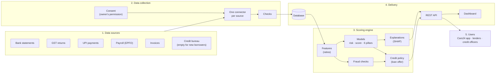
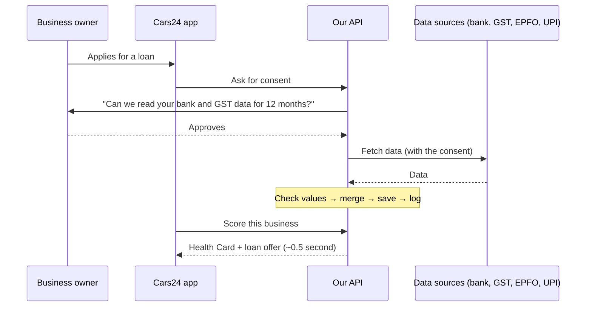
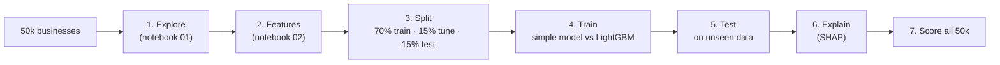

# Solution Architecture

**In one line:** with the business owner's permission, we collect their bank, GST, payroll and UPI data, turn it into a health score and a loan offer, explain the result, and serve it through an API and a dashboard.

## 1. End-to-end view

The system has five parts. Read the diagram left to right.

| Part | What it does | Where in the code |
|---|---|---|
| 1. Data sources | Where the business's financial data lives | Simulated by the 50k dataset |
| 2. Data collection | Ask permission, fetch each source, check the values | `api/main.py`, `connectors.py`, `schemas.py` |
| 3. Scoring engine | Build features, predict risk, check for fraud, explain, make the loan offer | `src/msme_health/` |
| 4. Delivery | Save results and serve them to apps and people | `api/main.py`, `store.py`, `dashboard/app.py` |
| 5. Users | The Cars24 app, partner lenders, credit officers | Through the API and dashboard |

**Key design choice:** training, the API and the dashboard all use the **same scoring code**. A feature is calculated the same way when the model is trained and when a live business is scored, so results never differ between the two.

## 2. Data collection (ingestion)

**Four steps: permission → fetch → check → store.**

| Step | What happens | In the demo | In production |
|---|---|---|---|
| 1. Permission | The owner approves which data, for what purpose and for how long. No permission, no data. | `POST /consents` creates a consent record | The owner approves in an RBI-regulated consent app (Account Aggregator) |
| 2. Fetch | Pull data from each source | `POST /msmes/{id}/fetch`: one connector per source, reading from the dataset | The same connectors, connected to the real sources |
| 3. Check | Reject impossible values (e.g. a percentage over 100) | Automatic checks on every field | Plus cross-checks between sources |
| 4. Store | Save the record and log every step | SQLite database + audit log | A production database (Postgres) |

A source can also **send its data on its own** (`POST /msmes/{id}/sources/{source}`), for example when new GST returns are filed.

**The API enforces consent:** fetching without a valid consent, or with another business's consent, is refused.

## 3. AI/ML workflow

**Seven steps: explore → build features → split → train → test → explain → score everyone.**

| Choice | What we did | Why, in plain words |
|---|---|---|
| What we predict | Probability of default (PD), the 0–100 health score, the 6 pillar scores | PD is what lenders decide on; the score and pillars are easy for people to read |
| Main model | LightGBM (many small decision trees) | Strong on table data, handles blanks, fast |
| Common-sense rules | "Monotonic constraints" on 14 features | Better behaviour can never give a worse score (e.g. filing GST on time can never raise risk) |
| Comparison model | Ridge (a simple straight-line model, like a bank scorecard) | Proves the complex model is worth it. Here both perform about the same. |
| Explanations | SHAP: how many points each factor added or removed | Every decision can be explained; decline reasons come from it |
| Fraud checks | 8 rules + Isolation Forest (flags the most unusual 2%) | Rules catch known tricks; the forest catches unusual patterns |
| Loan decision | A separate policy: risk band → eligible? → limit → conditions | The risk team can change rules without retraining the model |

**In production:** retrain regularly. Watch whether incoming data starts to look different from the training data, and only replace the model when a new one beats it on real repayment data.

## 4. Integration strategy

**Two questions: how does data come IN, and how does the result go OUT?**

### Data in

| Source | What it is | What we use from it |
|---|---|---|
| **Bank statements** (through an **Account Aggregator**) | RBI's consent system: the owner taps "approve" in an app and their bank shares statements | Money in and out, balance, overdraft use, EMIs |
| **GST portal** | Monthly tax returns, shared with the owner's OTP | Sales, purchases, whether GST was filed on time |
| **EPFO** | Monthly provident-fund filings by employers | Employees, salary total, salary paid on time |
| **UPI provider** | The business's payment app data | Daily transactions, payment size, UPI income |
| **GST e-invoices** | Invoices the business raises and receives | How fast customers pay, dependence on top customers, paying suppliers on time |
| **Credit bureau** (e.g. CIBIL) | Loan history | EMI record. **Optional**: empty for new-to-credit businesses, and the model works without it |
| **Business registration** (Udyam) | The MSME's official registration | Industry, business type, age, location |

**In the code:** every source sits behind **one common "connector" design** (`connectors.py`). The demo uses mock connectors that read from the dataset. Going live means replacing each mock with a real connector. **The model and the API do not change.** Adding a new source later is just one more connector.

### Result out

| Who | How they use it |
|---|---|
| **Cars24 app** | Calls the API when a dealer or fleet owner applies; shows the offer in seconds |
| **Partner lenders** | Cars24 can send the Health Card along with the loan application, so several lenders can make offers |
| **Credit officers** | Use the dashboard to review a business, its reasons and fraud flags |

Everything goes through the **REST API**, so any system in any language can use it.

## 5. Scaling up

### Measured (laptop, this repo)

| What | Time / size |
|---|---|
| Full card (8 models + SHAP + what-if), first view | 0.45 s (95% under 0.52 s) |
| Same card viewed again (saved) | 7 ms |
| Score only, no explanations | ~0.1 s (PD model alone: 22 ms) |
| Portfolio dashboard numbers | 13 ms |
| Re-score all 50,000 businesses | 5.7 s |
| Memory per API copy | ~350 MB |
| One saved card | ~9 KB |

### Capacity (estimate)

One copy handles about **2 full cards a second**. Explanations take about 80% of that time.

- **Assume 10,000 applications a day**, with 15% in the busiest hour. That is about 1,500 an hour, or one every 2–3 seconds. **One small server is enough, with about 5× headroom.**
- **At 1 lakh a day**, the peak is about 4 a second. **3–4 copies** (about 1.4 GB in total) fit on one 4-core server.
- **At 10 lakh (1 million) a day**, the peak is about 42 a second. That needs **about 20 copies** (about 7 GB in total) on 5–6 servers, behind a load balancer that adds copies automatically. If the decision comes first and explanations later, **about 6 copies** are enough.
- **Batch:** 10 lakh businesses re-scored in about 2 minutes.
- **Storage:** 10 lakh cards a month is about 9 GB a month.

Quick formula: peak per second = daily applications × 0.15 ÷ 3,600. Divide by 2 to get the number of copies needed.

### What changes as it grows

| Topic | Today (demo) | With more traffic |
|---|---|---|
| More users | One server | The API keeps no memory between requests, so we run more copies of it |
| Saved data | SQLite, a file on one server | One shared Postgres, so every copy sees the same consents, cards and audit log. **This is the first thing to break.** |
| Speed | Decision and explanations together (0.45 s) | Return the decision first (~0.1 s) and compute explanations in the background. Saved cards return in 7 ms. |
| Data arriving | Direct API calls | A queue per source, so nothing is lost if a source is slow |
| Whole portfolio | 50k scored in under 6 s | Scheduled nightly batch job |
| Models | Saved files in the repo | Versioned, so we can roll back to an older model |
| Hosting | Render free tier, which sleeps when idle (first request takes about 1 min) | A paid plan that is always on |

## 6. Security and compliance

- **Consent first:** no data is fetched without the owner's permission, and data is used only for the stated purpose (India's data-protection law, DPDP Act 2023).
- **Explainable decisions:** every decline has reasons, as RBI's fair-lending rules expect.
- **Audit log:** every consent, fetch, score and decision is recorded.
- **Fairness:** accuracy is checked separately for new-to-credit, new-to-bank and existing borrowers. No personal attributes (gender, religion and so on) are used.
- **Production:** encrypt data, mask personal details, delete data when consent expires.

## 7. Technology stack

| Layer | Technology |
|---|---|
| Language | Python 3.12 |
| Data | pandas, NumPy |
| ML | LightGBM, scikit-learn (Ridge, Isolation Forest), SHAP |
| API | FastAPI (auto-generated docs at `/docs`) |
| Dashboard | Streamlit + Plotly |
| Storage | SQLite (demo) → Postgres (production) |
| Notebooks | Jupyter |
| Testing | pytest (19 tests) |
| Deployment | Render, Docker |
