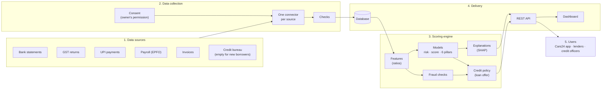
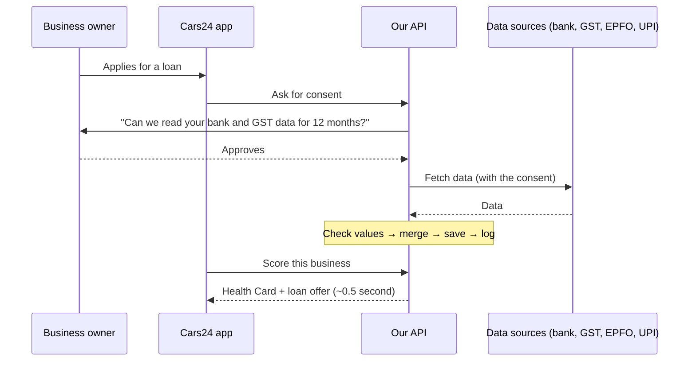
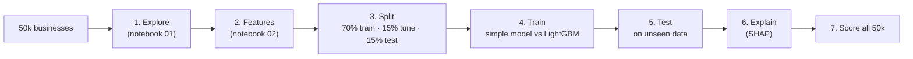
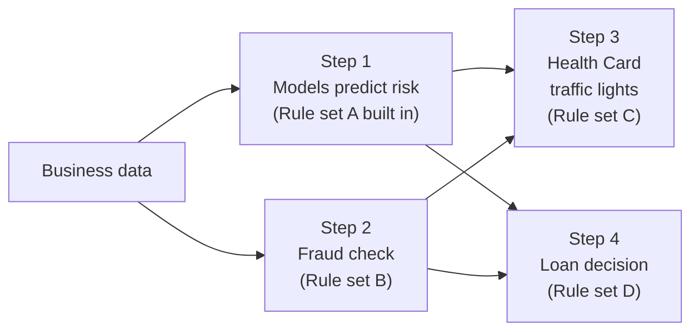

# Solution Architecture

**In one line:** with the business owner's permission, we collect their bank, GST, payroll and UPI data, turn it into a health score and a loan offer, explain the result, and serve it through an API and a dashboard.

## 1. End-to-end view

The system has five parts. Read the diagram left to right.

| Part | What it does | Where in the code |
|---|---|---|
| 1. Data sources | Where the business's financial data lives | Simulated by the 50k dataset |
| 2. Data collection | Ask permission, fetch each source, check the values | `api/main.py`, `connectors.py`, `schemas.py` |
| 3. Scoring engine | Build features, predict risk, check for fraud, explain, make the loan offer | `src/msme_health/` |
| 4. Delivery | Save results and serve them to apps and people | `api/main.py`, `store.py`, `dashboard/app.py` |
| 5. Users | The Cars24 app, partner lenders, credit officers | Through the API and dashboard |

**Key design choice:** training, the API and the dashboard all use the **same scoring code**. A feature is calculated the same way when the model is trained and when a live business is scored, so results never differ between the two.

## 2. Data collection (ingestion)

**Four steps: permission → fetch → check → store.**

| Step | What happens | In the demo | In production |
|---|---|---|---|
| 1. Permission | The owner approves which data, for what purpose and for how long. No permission, no data. | `POST /consents` creates a consent record | The owner approves in an RBI-regulated consent app (Account Aggregator) |
| 2. Fetch | Pull data from each source | `POST /msmes/{id}/fetch`: one connector per source, reading from the dataset | The same connectors, connected to the real sources |
| 3. Check | Reject impossible values (e.g. a percentage over 100) | Automatic checks on every field | Plus cross-checks between sources |
| 4. Store | Save the record and log every step | SQLite database + audit log | A production database (Postgres) |

A source can also **send its data on its own** (`POST /msmes/{id}/sources/{source}`), for example when new GST returns are filed.

**The API enforces consent:** fetching without a valid consent, or with another business's consent, is refused.

## 3. AI/ML workflow

**Seven steps: explore → build features → split → train → test → explain → score everyone.**

| Choice | What we did | Why, in plain words |
|---|---|---|
| What we predict | Probability of default (PD), the 0–100 health score, the 6 pillar scores | PD is what lenders decide on; the score and pillars are easy for people to read |
| Main model | LightGBM (many small decision trees) | Strong on table data, handles blanks, fast |
| Common-sense rules | "Monotonic constraints" on 14 features (full list in [Rules used at each step](#rules-used-at-each-step)) | Better behaviour can never give a worse score (e.g. filing GST on time can never raise risk) |
| Comparison model | Ridge (a simple straight-line model, like a bank scorecard) | Proves the complex model is worth it. Here both perform about the same. |
| Explanations | SHAP: how many points each factor added or removed | Every decision can be explained; decline reasons come from it |
| Fraud checks | 8 rules + Isolation Forest (flags the most unusual 2%) | Rules catch known tricks; the forest catches unusual patterns |
| Loan decision | A separate policy: risk band → eligible? → limit → conditions | The risk team can change rules without retraining the model |

**In production:** retrain regularly. Watch whether incoming data starts to look different from the training data, and only replace the model when a new one beats it on real repayment data.

### Rules used at each step

The models give numbers. **Rules** keep those numbers logical, check the data is honest, and turn risk into a loan decision. There are four sets of rules, and each one works at a different step:

| Step | Rule set | What it does | Where in the code |
|---|---|---|---|
| 1. Predict risk | **A. Direction rules** (14) | Better behaviour can never give a worse result | `features.py` → `PD_MONOTONE`, used in `train.py` |
| 2. Fraud check | **B. Fraud rules** (8) + Isolation Forest | Checks that bank, GST and UPI numbers agree | `anomaly.py` → `RULES` |
| 3. Health Card | **C. Traffic-light rules** (9) | Marks each risk indicator OK / Watch / High | `engine.py` → `_risk_indicators` |
| 4. Loan decision | **D. Credit policy** | Risk group, loan amount, yes/no, conditions | `config.py` → `POLICY`, `recommend.py` |

#### Rule set A: direction rules (inside the models)

**What:** for 14 features, the model is told which way they are allowed to push risk. It can learn *how much* each one matters, but never the opposite direction.

**Why:** without them, the model can learn silly patterns from random noise, for example "filing GST 85% on time is riskier than 80%". With them, a business that improves can never see its score drop. Tested: accuracy is the same with or without these rules (PD R² 0.912 both ways).

**How:** a list of +1 / −1 / 0 per feature is passed to LightGBM (`monotone_constraints`). While building each tree, LightGBM refuses any split that breaks the direction. The health score model uses the same list flipped, because a higher score means lower risk.

| When this goes up, risk can only go **up** | Plain meaning |
|---|---|
| Transaction volatility | Money in and out swings a lot |
| Overdraft usage | Borrowing more on the overdraft |
| Employee attrition | Staff leaving |
| Customer payment delay (days) | Customers pay late |
| Customer concentration | Depends on a few big customers |
| EMI burden | EMI ÷ monthly bank income |

| When this goes up, risk can only go **down** | Plain meaning |
|---|---|
| GST filed on time % | Pays tax returns on time |
| Cash-flow stability | Steady money in and out |
| EMIs paid on time % | Repays existing loans on time |
| Salaries paid on time % | Pays staff on time |
| Suppliers paid on time % | Pays vendors on time |
| Years in operation | Older, established business |
| Balance cover (months) | Months of spending the bank balance can cover |
| Lean-month surplus ratio | Cash left over in the slowest month |

The other 30 features have no rule, because their direction is not obvious (e.g. more employees is not automatically safer).

#### Rule set B: fraud rules (data consistency)

**What:** 8 checks that compare what different sources say about the same business. An honest business tells the same story in its bank, GST and UPI data.

**Why:** the data has no fraud labels, so a model cannot learn fraud directly. Comparing sources catches the common tricks, and each flag comes with a clear message.

**How:** each rule is one line: *(number to check, limit, message)*. The code goes down the list for every business and records any rule that fails. Each limit sits just beyond the most extreme 1% of normal businesses, so only truly odd cases are caught.

| # | Flag raised when… | Possible meaning |
|---|---|---|
| 1 | Bank income is more than 25% **above** GST sales | Money going in circles, or sales hidden from GST |
| 2 | Bank income is more than 20% **below** GST sales | GST sales inflated with fake invoices |
| 3 | GST sales (×12) are more than 25% above declared turnover | Declared turnover does not match tax filings |
| 4 | Declared turnover is more than 30% above GST sales (×12) | Turnover inflated on the application |
| 5 | UPI income is more than total bank income | Impossible: UPI is part of bank income |
| 6 | Monthly payroll is more than monthly GST sales | Ghost employees, or a loss-making business |
| 7 | Monthly spending is more than 10% above monthly income | Burning cash every month |
| 8 | Existing EMIs take more than 45% of monthly bank income | Hidden or excessive debt |

**Plus the Isolation Forest:** it flags the most unusual 2% of businesses overall, even when no single rule fails. An odd business gets separated from the rest in very few random cuts; a normal one needs many.

**What a flag does:** it does **not** decline the business. It sends it to a human underwriter, because a mismatch can have an honest reason.

**Tested** by planting fake frauds in the test data: rules + forest caught 100% of circular transactions, inflated GST and hidden debt, and 40% of ghost payroll.

#### Rule set C: traffic lights on the Health Card

**What:** each risk indicator on the card gets a colour, so a credit officer sees problems at a glance.

**How:** two limits per indicator: past the first it is **Watch** (amber), past the second it is **High** (red). Otherwise it is **OK**.

| Indicator | Watch (amber) if | High (red) if |
|---|---|---|
| Overdraft usage | above 30% | above 40% |
| Transaction volatility | above 0.35 | above 0.45 |
| Customer concentration | above 55% | above 70% |
| Days customers take to pay | above 20 days | above 30 days |
| EMI share of income | above 20% | above 30% |
| Cash left in the slowest month | below 5% of monthly income | below zero |
| Revenue growth | below 0% | below −10% |
| Employee attrition | above 22% | above 30% |
| Data consistency | Isolation Forest finds it unusual | any fraud rule fails |

#### Rule set D: credit policy (the loan decision)

**What:** turns the predicted risk (PD) into a decision: yes or no, how much, for how long, and on what conditions.

**Why kept separate from the model:** the model estimates risk; the policy decides what to do with it. The risk team can change any number in `config.py` without retraining a model.

**Step 1: risk group from PD**

| PD | Risk group | Loan limit (% of yearly turnover) | Tenure | Indicative rate |
|---|---|---|---|---|
| below 6% | Low | 16% | 36 months | 14% |
| 6% to 15% | Medium | 8% | 24 months | 18% |
| above 15% | High | not eligible | – | – |

The 6% / 15% cut-offs and the 16% / 8% limits match the supplied data. Tenure and rate are assumptions, used to work out the EMI.

**Step 2: loan amount = the lower of two limits**

- **Size limit:** yearly turnover × 16% (Low) or 8% (Medium).
- **Affordability limit:** the largest loan whose monthly EMI fits in **half of the monthly savings** (bank income − bank spending).

The final amount is rounded down to the nearest ₹1,000. The affordability limit protects businesses that sell a lot but save little. It lowers the limit for about 12% of approved businesses.

**Step 3: decision, checked in this order**

| Order | If… | Decision |
|---|---|---|
| 1 | Risk group is High | **Decline** (reason: PD above 15%) |
| 2 | No monthly savings | **Decline** (reason: no surplus to pay an EMI) |
| 3 | Any fraud flag, or Isolation Forest finds it unusual | **Refer to underwriter** |
| 4 | Risk group is Medium | **Approve with conditions** |
| 5 | Otherwise (Low) | **Approve** |

**Step 4: conditions added to an approval**

| If… | Condition added |
|---|---|
| Cash in the slowest month cannot cover the EMI | Offer a seasonal or step-down EMI |
| Risk group is Medium | Monthly check of bank data through the Account Aggregator |
| Top customers are more than 60% of sales | Consider invoice-backed financing |
| No credit history (new-to-credit) | Start with a smaller loan; increase after 6 on-time EMIs |

## 4. Integration strategy

**Two questions: how does data come IN, and how does the result go OUT?**

### Data in

| Source | What it is | What we use from it |
|---|---|---|
| **Bank statements** (through an **Account Aggregator**) | RBI's consent system: the owner taps "approve" in an app and their bank shares statements | Money in and out, balance, overdraft use, EMIs |
| **GST portal** | Monthly tax returns, shared with the owner's OTP | Sales, purchases, whether GST was filed on time |
| **EPFO** | Monthly provident-fund filings by employers | Employees, salary total, salary paid on time |
| **UPI provider** | The business's payment app data | Daily transactions, payment size, UPI income |
| **GST e-invoices** | Invoices the business raises and receives | How fast customers pay, dependence on top customers, paying suppliers on time |
| **Credit bureau** (e.g. CIBIL) | Loan history | EMI record. **Optional**: empty for new-to-credit businesses, and the model works without it |
| **Business registration** (Udyam) | The MSME's official registration | Industry, business type, age, location |

**In the code:** every source sits behind **one common "connector" design** (`connectors.py`). The demo uses mock connectors that read from the dataset. Going live means replacing each mock with a real connector. **The model and the API do not change.** Adding a new source later is just one more connector.

### How it plugs into India's lending rails

The brief names five systems. This is what each one is and how we use it.

| System | What it is, in plain words | How we use it |
|---|---|---|
| **Account Aggregator (AA)** | RBI's consent system for financial data. The owner approves in an app, and their bank sends statements directly to us. | Our main way to get bank statements. Our consent step follows the AA flow: which data, what purpose, how long. |
| **GSTN** | The GST Network, the government's tax system. Access goes through a licensed GST provider, with the owner's OTP. | GST returns: sales, purchases, filing on time. Drives the compliance and revenue scores. |
| **ULI** (Unified Lending Interface) | RBI's single gateway for lenders. One connection gives access to many data sources: GST, bank data via AA, land records, PAN checks and more. | Instead of building a separate connector for every source, we can fetch through ULI. It is just one more connector in our design. |
| **OCEN** (Open Credit Enablement Network) | A common "language" (standard APIs) that lets platforms like Cars24 connect to many lenders at once. Cars24 acts as the loan marketplace. | The Health Card and loan offer go with the loan application over OCEN, so several lenders can compete to make an offer. |
| **Banking APIs** | Banks' own APIs for checking an account, fetching statements and paying out the loan. | Verify the business's account, and pay out the loan once a lender approves. |

### Result out

| Who | How they use it |
|---|---|
| **Cars24 app** | Calls the API when a dealer or fleet owner applies; shows the offer in seconds |
| **Partner lenders** | Over OCEN, Cars24 sends the Health Card with the loan application, so several lenders can make offers |
| **Credit officers** | Use the dashboard to review a business, its reasons and fraud flags |

Everything goes through the **REST API**, so any system in any language can use it.

## 5. Scaling up

### Measured (laptop, this repo)

| What | Time / size |
|---|---|
| Full card (8 models + SHAP + what-if), first view | 0.45 s (95% under 0.52 s) |
| Same card viewed again (saved) | 7 ms |
| Score only, no explanations | ~0.1 s (PD model alone: 22 ms) |
| Portfolio dashboard numbers | 13 ms |
| Re-score all 50,000 businesses | 5.7 s |
| Memory per API copy | ~350 MB |
| One saved card | ~9 KB |

### How we scale (high level)

1. **Load balancer + autoscaling.** Run many copies of the API behind a load balancer, which sends each request to a free copy. Autoscaling adds copies when traffic rises and removes them when it drops. This works because the API keeps no memory between requests.
2. **Cache.** Save each computed card in a fast store (e.g. Redis). A repeat request returns in 7 ms instead of 0.45 s. When new data arrives for a business, clear its saved card.
3. **Decision first, explanations later.** Return the score and loan offer in about 0.1 s. Compute SHAP explanations in the background, since they take about 80% of the time.
4. **Queue for slow or bursty work.** Explanations, re-scoring on new GST or bank data, and fetching from data sources go through a queue (e.g. Kafka or SQS). During a spike, jobs wait safely instead of crashing the system.
5. **Rate limits per partner.** An API gateway checks API keys and limits how many requests each partner can send, so one faulty caller cannot slow down everyone.
6. **Features prepared in advance.** Fetch bank and GST data when consent is given and store the ready features. Real-time scoring then only reads features and runs the model.
7. **Score in small batches.** Scoring together costs about 0.1 ms per business (50k in 5.7 s), against about 0.1 s one at a time. Grouping requests for a few milliseconds multiplies what each copy can handle.
8. **One shared Postgres.** It replaces SQLite, so every copy sees the same consents, cards and audit log. This is the first thing to change.
9. **Nightly batch** for re-scoring the whole portfolio, and **versioned models** that can be rolled back.
10. **Monitoring.** Track response time, errors, requests per second and queue length, and alert when they go past limits.

## 6. Technology stack

| Layer | Technology |
|---|---|
| Language | Python 3.12 |
| Data | pandas, NumPy |
| ML | LightGBM, scikit-learn (Ridge, Isolation Forest), SHAP |
| API | FastAPI (auto-generated docs at `/docs`) |
| Dashboard | Streamlit + Plotly |
| Storage | SQLite (demo) → Postgres (production) |
| Notebooks | Jupyter |
| Testing | pytest (19 tests) |
| Deployment | Render, Docker |
